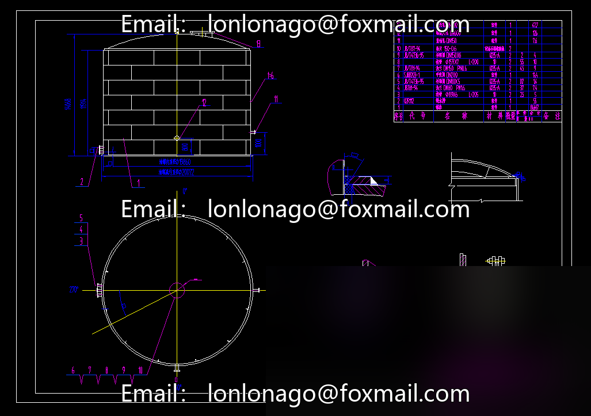
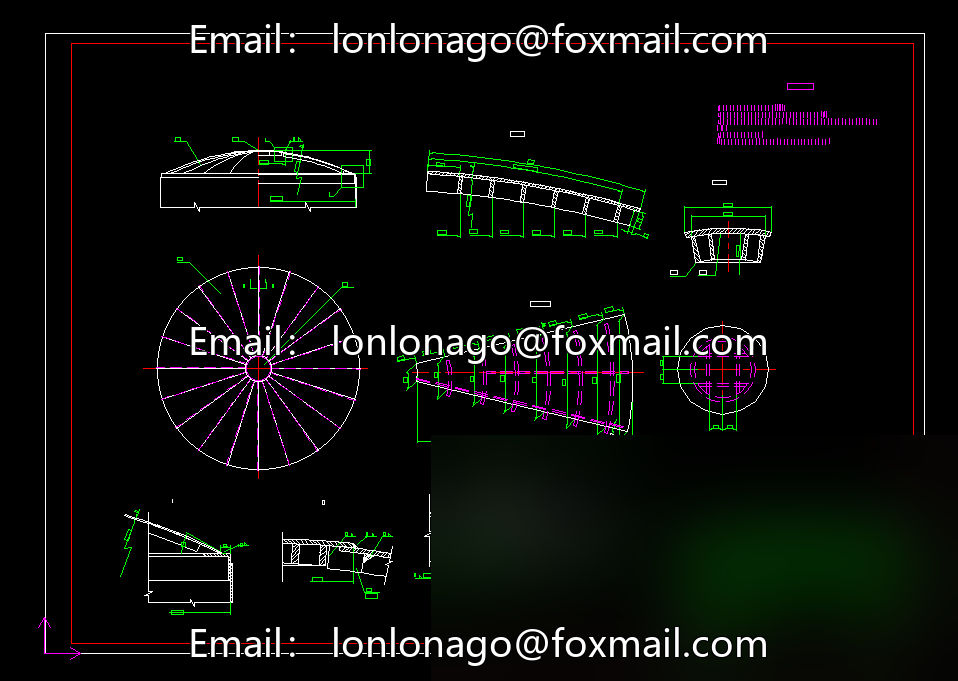
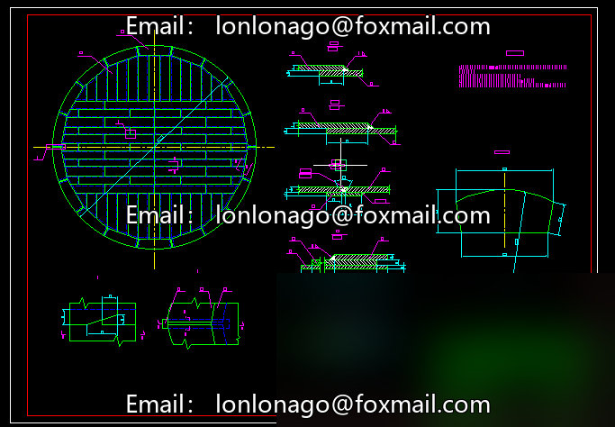
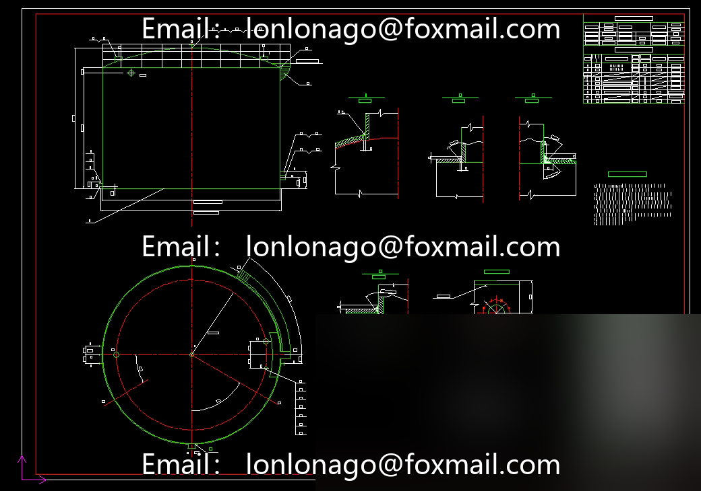

# Arch base oil tank CAD design drawing

## Body

Arch cap oil tank CAD design drawing 493-Arch cap oil tank drawing Arch cap oil tank design Arch cap oil tank CAD drawing Arch cap oil tank design drawing Arch cap oil tank two-dimensional drawing

The design diagrams for an arched oil tank include wall drawings, bottom drawings and multiple tank-related drawings and design resources.

<!-- AI_ENRICHED -->

## Images

## Payment

Here is a pay link on Stripe ( https://buy.stripe.com/3cs8yP7sY87d0vu9AB ). Please contact me lonlonago@foxmail.com after funding $89, and I will send you a complete data files , thank you!

